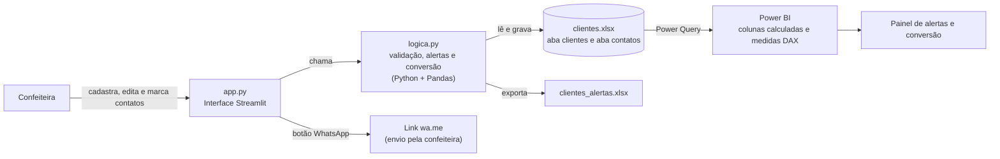

# [ADS2] Projeto Integrador - Big Data com Python em Empresa Parceira

## Resumo do Projeto
Sistema de apoio à decisão (SAD) para a **Bolos da Lyz**, confeitaria artesanal (MEI). O sistema substitui o caderno de anotações por um cadastro de clientes em Python e emite alertas de aniversário **30 e 60 dias antes da data**, para que a confeiteira contate o cliente a tempo e ofereça bolos e doces (fidelização e recompra).

O projeto percorre, em pequena escala, o fluxo de um pipeline de dados: **ingestão** (cadastro manual) → **tratamento** (validação com Python/Pandas) → **armazenamento** (Excel estruturado) → **processamento** (alertas e taxa de conversão) → **consumo** (painel no Power BI).

## Integrantes e Responsabilidades
| Nome Completo | Matrícula | Usuário GitHub | Função no Projeto |
| :--- | :--- | :--- | :--- |
| Matheus de Almeida Flores | 202502541831 | @omatheusflores96 | Desenvolvedor |
| Igor Esteferson Vacario | 202503944202 | @IgorVacario | Desenvolvedor |
| Klaydiana da Silva Medeiros | 202502264811 | @daianamedeirossilva86-svg | Gerente de Projeto |
| Maria Eloisa de Oliveira Freitas | 202408452969 | @Maria20241413 | Analista de Negócio |

## Funcionalidades
* Cadastro, edição e remoção de clientes (nome, telefone e dia/mês do aniversário), com validação de telefone, de datas e de duplicidade.
* Alertas por janela de tempo: **30 dias** (urgente) e **60 dias** (atenção), com filtro.
* Botão de WhatsApp (link `wa.me`) com mensagem pronta para cada cliente em alerta. O envio é sempre feito pela confeiteira.
* Registro de contatos e pedidos e cálculo da **taxa de conversão** (pedidos confirmados ÷ contatos feitos).
* Exportação da lista de clientes com os alertas em Excel.
* Tratamento de erros: arquivo corrompido, aba ou coluna ausente geram mensagens claras, e registros inválidos da planilha são ignorados nos alertas e listados com o motivo.
* Painel no Power BI com os indicadores e os alertas.

## Arquitetura de dados

| Etapa do pipeline | Onde acontece |
| :--- | :--- |
| Ingestão | Formulário de cadastro no Streamlit (`app.py`) |
| Tratamento | Limpeza e validação de telefone, data e duplicidade (`logica.py`) |
| Armazenamento | `clientes.xlsx`, com as abas `clientes` e `contatos` |
| Processamento | Cálculo do próximo aniversário, dos dias restantes, do status e da taxa de conversão (`logica.py`) |
| Consumo | Interface (aba Alertas), exportação em Excel e painel no Power BI |

## Dicionário de dados

### Camada armazenada: aba `clientes`
| Campo | Tipo | Descrição | Regras |
| :--- | :--- | :--- | :--- |
| `nome` | texto | Nome do cliente | Obrigatório; espaços extras removidos |
| `telefone` | texto | DDD + número, só dígitos (ex.: `32912345678`) | Chave do cliente; 10 ou 11 dígitos; sem duplicidade; símbolos e código `55` removidos |
| `dia` | inteiro | Dia do aniversário | Entre 1 e 31; a combinação dia/mês precisa existir (31/02 é bloqueado e 29/02 é aceito) |
| `mes` | inteiro | Mês do aniversário | Entre 1 e 12 |

O ano de nascimento não é armazenado.

### Camada armazenada: aba `contatos`
| Campo | Tipo | Descrição | Regras |
| :--- | :--- | :--- | :--- |
| `telefone` | texto | Telefone do cliente contatado | Liga o contato ao cliente |
| `nome` | texto | Nome do cliente no momento do contato | |
| `data_contato` | texto (AAAA-MM-DD) | Data em que a confeiteira marcou "Contatei" | |
| `ano_aniversario` | inteiro | Ano do aniversário que motivou o contato | Separa os ciclos: um contato de um ano não vale para o seguinte |
| `pedido_confirmado` | texto | Resultado do contato | `Aguardando` (inicial), `Sim` ou `Não` |

### Camada processada (calculada, não gravada no Excel)
| Campo | Tipo | Descrição | Regra |
| :--- | :--- | :--- | :--- |
| `proximo_aniversario` | data | Próxima data de aniversário a partir de hoje | Usa o ano atual se a data ainda não passou; senão, o ano seguinte. 29/02 em ano não bissexto vira 28/02 |
| `dias_restantes` | inteiro | Dias entre hoje e `proximo_aniversario` | |
| `status` | texto | Nível do alerta | `URGENTE (30 dias)` de 0 a 30; `ATENÇÃO (60 dias)` de 31 a 60; `Fora da janela` acima de 60 |
| `contato` | texto | Situação do contato no ciclo atual | `Não contatado`, `Aguardando resposta`, `Pedido confirmado` ou `Sem pedido` |

### Camada analítica (Power BI)
Medidas definidas em `medidas_dax.txt`: `Contatos Feitos`, `Pedidos Confirmados`, `Taxa de Conversão` (= Pedidos Confirmados ÷ Contatos Feitos), `Urgentes a Contatar` e `Atenção a Contatar`.

## Stack Tecnológica
* **Linguagem:** Python 3.10+
* **Interface:** Streamlit
* **Tratamento de dados:** Pandas e openpyxl
* **Armazenamento:** Excel (`clientes.xlsx`)
* **Dashboard:** Power BI Desktop
* **Gestão e Versão:** Git, GitHub, Trello e Teams

## Estrutura do repositório
| Arquivo ou pasta | Função |
| :--- | :--- |
| `app.py` | Interface web (cadastro, alertas e lista de clientes) |
| `logica.py` | Regras de negócio: validações, leitura e gravação do Excel, alertas, contatos, conversão e exportação |
| `teste_logica.py` | Testes automáticos das regras |
| `requirements.txt` | Dependências do projeto |
| `powerquery_contatos.m` e `powerquery_clientes.m` | Consultas do Power BI que leem o Excel |
| `medidas_dax.txt` | Medidas do Power BI |
| `.gitignore` | Impede o envio de arquivos com dados reais e de arquivos temporários |

## Como executar (reprodução do pipeline)
Pré-requisito: **Python 3.10 ou superior**.

1. Clone o repositório:
   `git clone https://github.com/omatheusflores96/ads-projeto-semestre2-grupo1.git`
2. Acesse a branch de desenvolvimento:
   `git checkout develop`
3. (Recomendado) Crie e ative um ambiente virtual:
   `python -m venv .venv`
   Windows: `.venv\Scripts\activate` | Linux/macOS: `source .venv/bin/activate`
4. Instale as dependências:
   `pip install -r requirements.txt`
5. Rode o sistema (abre no navegador em `http://localhost:8501`):
   `python -m streamlit run app.py`
6. Rode os testes (se aparecer "Todos os testes passaram", está tudo certo):
   `python teste_logica.py`

O arquivo `clientes.xlsx` é criado automaticamente no primeiro uso, na pasta onde o comando é executado.

### Variáveis de ambiente
| Variável | Obrigatória | Descrição |
| :--- | :--- | :--- |
| `CLIENTES_XLSX` | Não | Caminho do arquivo Excel usado pelo sistema. Se não for definida, usa `clientes.xlsx` na pasta atual |

Exemplos (defina antes de rodar o `python -m streamlit run app.py`):
* Windows (cmd): `set CLIENTES_XLSX=C:\BolosDaLyz\clientes.xlsx`
* Windows (PowerShell): `$env:CLIENTES_XLSX="C:\BolosDaLyz\clientes.xlsx"`
* Linux/macOS: `export CLIENTES_XLSX=/caminho/clientes.xlsx`

### Dados utilizados
Os dados reais da Bolos da Lyz ficam **somente no computador local**, no arquivo `clientes.xlsx`, que não é enviado ao GitHub (está no `.gitignore`). Para rodar o sistema:

* Na primeira execução, o app cria um `clientes.xlsx` vazio na pasta do projeto. Cadastre os clientes pela aba **Cadastrar**.
* Para usar uma planilha que já exista (aba `clientes`, com as colunas `nome`, `telefone`, `dia` e `mes`), coloque-a na pasta do projeto com o nome `clientes.xlsx` ou aponte para ela com a variável `CLIENTES_XLSX`.

Os alertas dependem da data de hoje, então os clientes que aparecem nas janelas de 30 e 60 dias mudam conforme o dia da execução.

## Como conectar o Power BI
1. No Power BI Desktop, vá em **Transformar dados → Nova Fonte → Consulta Nula → Editor Avançado** e cole o conteúdo de `powerquery_contatos.m`. Dê à consulta o nome **Contatos**.
2. Repita com `powerquery_clientes.m`, com o nome **Clientes**.
3. Troque o caminho do arquivo (`C:\BolosDaLyz\clientes.xlsx`) pelo local do seu `clientes.xlsx` nos dois códigos.
4. Clique em **Fechar e Aplicar** e crie as medidas do `medidas_dax.txt` (Modelagem → Nova medida, uma por vez).
5. Sempre que houver dados novos, clique em **Atualizar**: o Power BI Desktop não atualiza sozinho.

O arquivo `.pbix` não está no repositório, porque guarda uma cópia dos dados importados. Para reproduzir o painel, siga os passos acima usando o seu próprio `clientes.xlsx`.

## Validação com a cliente
* **Participante:** Lyzandra — Proprietária da confeitaria *Bolos da Lyz* (uso autorizado mediante consentimento formal).
* **Data e formato:** 23/11/2026, sessão presencial assistida com duração de 40 minutos (conduzida por Matheus de Almeida Flores).
* **Teste guiado de tarefas:** **100% de conclusão autônoma** (7 de 7 tarefas realizadas sozinha sem erros ou bloqueios, cobrindo cadastro, validação de telefone inválido, filtro de alertas de 30/60 dias, envio via WhatsApp, registro de contato/pedido, edição cadastral e leitura/exportação no Power BI).
* **Métricas quantitativas:**
  * **Média geral (Escala Likert 1–5):** **4,90 / 5,00** (nota 5,0 em *Utilidade*, *Confiabilidade* e *Ganho*; nota 4,67 em *Usabilidade*, com nota 4 na clareza do painel Power BI).
  * **Net Promoter Score (NPS):** **10 / 10** (perfil promotor).
* **Depoimento autorizado:** *"É um sistema diferente e muito interessante, que realmente ajuda na fidelização dos clientes."*
* **Relatório completo:** disponível em PDF na entrega da disciplina (`relatorio_avaliacao_bolos_da_lyz.pdf`).

## Limitações e próximos passos
* O Power BI Desktop precisa ser atualizado manualmente (evolução: Power BI Service com gateway).
* O Excel não suporta uso simultâneo por vários usuários e precisa estar fechado durante a gravação (evolução: migração para banco de dados, como o SQLite).
* Evoluções previstas: exportação em CSV, importação em lote de contatos, outras datas comemorativas (Dia das Mães, Páscoa e Natal) e histórico de pedidos e preferências.

## Observações
* O `clientes.xlsx` real contém dados pessoais (nomes e telefones). Ele e o painel `.pbix` ficam apenas no computador local e estão no `.gitignore`: **não envie para o GitHub**.
* Se o arquivo estiver aberto no Excel, o app avisa para fechá-lo antes de salvar.